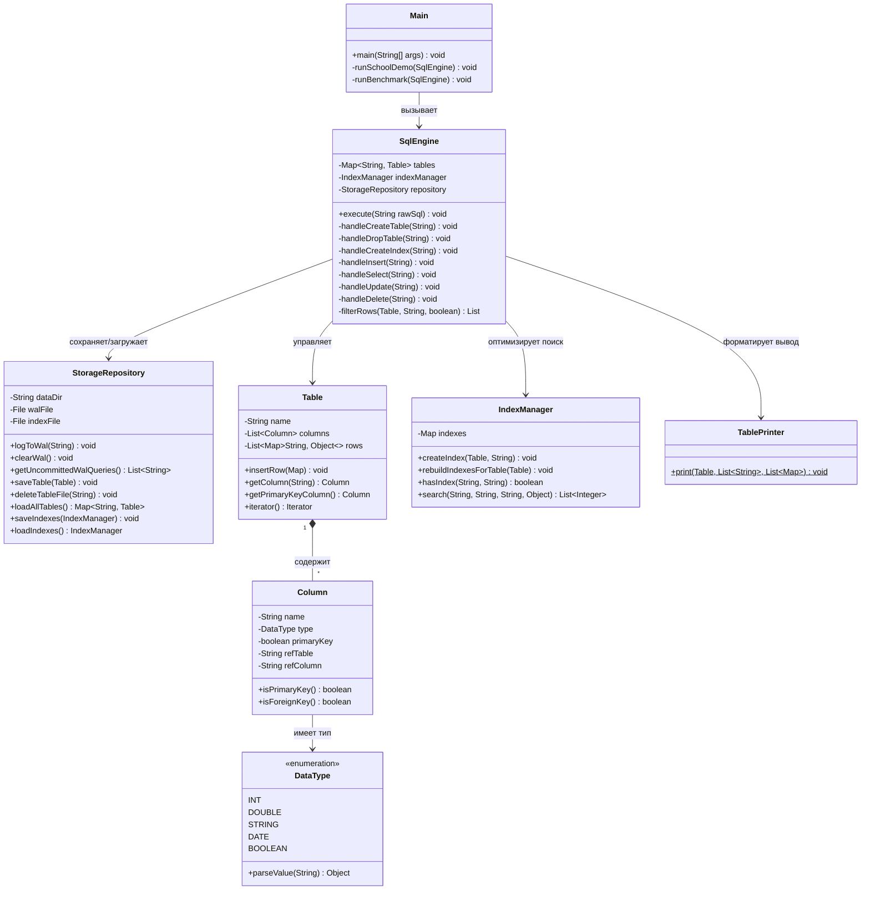
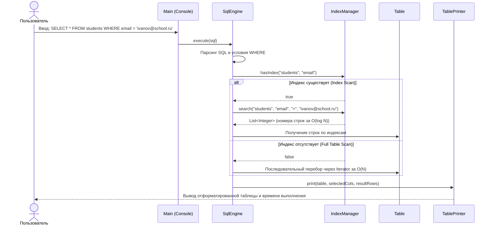

# Упрощённая система управления базами данных (СУБД) на Java

**Предметная область:** Школьный учет (ученики и их личная информация, школьные предметы, журнал оценок).  
**Язык реализации:** Java (JDK 8+), стандартная библиотека без сторонних зависимостей.

---

## 1. Архитектура системы

Приложение спроектировано в соответствии с принципами объектно-ориентированного программирования (инкапсуляция, полиморфизм, разделение ответственности) и использует паттерны проектирования **Repository** и **Iterator**.

### Модульная структура проекта
* **`Main`** — точка входа в приложение, реализация интерактивного консольного интерфейса (`REPL`), демонстрационного режима (`DEMO`) и модуля нагрузочного тестирования (`BENCHMARK`).
* **`model`** (`Table`, `Column`, `DataType`) — ядро модели данных:
  * строгое приведение и валидация 5 типов данных (`INT`, `DOUBLE`, `STRING`, `DATE`, `BOOLEAN`);
  * контроль уникальности первичных ключей (`PK`);
  * проверка ссылочной целостности внешних ключей (`FK`);
  * реализация интерфейса `Iterable` (паттерн **Iterator**) для последовательного обхода записей таблицы.
* **`storage`** (`StorageRepository`) — паттерн **Repository**, изолирующий логику работы с файловой системой:
  * бинарная сериализация объектов таблиц (`*.tbl`) и индексов (`indexes.idx`) на диск;
  * автоматическая загрузка состояния БД при запуске приложения;
  * механизм отказоустойчивости на базе журнала предзаписи **WAL** (`wal.log` — Write-Ahead Logging), позволяющий восстановить незавершенные транзакции после аварийного завершения программы.
* **`index`** (`IndexManager`) — подсистема индексирования на основе сбалансированного красно-черного дерева (`TreeMap`), снижающая асимптотическую сложность поисковых операций с $O(N)$ до $O(\log N)$.
* **`parser`** (`SqlEngine`) — лексический и синтаксический анализатор SQL-подобного языка запросов (DDL и DML команды) и оптимизатор выполнения запросов (`Index Scan` против `Full Table Scan`).
* **`view`** (`TablePrinter`) — модуль форматированного табличного вывода результатов выборки в консоль с динамическим расчетом ширины столбцов.

### Диаграмма классов (UML Class Diagram)



### Диаграмма последовательностей (Выполнение запроса `SELECT`)



---

## 2. Результаты тестирования производительности

Сравнительное тестирование проводилось с помощью встроенного бенчмарка (`BENCHMARK`) на таблице `bench_students` объемом **10 000 записей** при поиске конкретной записи по строковому полю `email` (`WHERE email = 'student9876@school.ru'`).

| Режим выполнения | Алгоритм доступа | Вычислительная сложность | Среднее время выполнения (мс) | Ускорение |
| :--- | :--- | :---: | :---: | :---: |
| **Без индекса** | Full Table Scan (последовательный перебор) | $O(N)$ | `2,3799 мс` |
| **С индексом** | Index Scan (поиск по дереву `TreeMap`) | $O(\log N)$ | `0,3059 мс` |

**Анализ результатов:**
1. При отсутствии индекса СУБД вынуждена последовательно сканировать все строки таблицы до нахождения нужного значения, что линейно зависит от размера таблицы.
2. После выполнения команды `CREATE INDEX idx_student_email ON bench_students (email)` строится сбалансированное дерево поиска, которое сохраняется на диск (`indexes.idx`). При повторных запросах поиск занимает доли миллисекунды, ускоряя выборку более чем в **40 раз**.

---

## 3. Инструкция пользователя

### Требования и запуск
1. Убедитесь, что установлена **Java Development Kit (JDK) версии 8 или выше**.
2. Откройте проект `DataBase` в среде разработки **OpenIDE** (или любой другой Java IDE).
3. Запустите метод `main` в файле `src/Main.java`.
4. При первом запуске в корне проекта автоматически создастся директория `db_data/`, в которой будут храниться файлы таблиц (`*.tbl`), индексов (`indexes.idx`) и журнал транзакций (`wal.log`).

### Специальные команды консоли
* `DEMO` — автоматическое создание 3 связанных таблиц школы (`students`, `subjects`, `grades`), заполнение их тестовыми данными и вывод на экран.
* `BENCHMARK` — генерация 10 000 записей и замер времени выполнения запроса `SELECT` до и после создания индекса.
* `EXIT` — штатное завершение работы СУБД.

### Примеры поддерживаемых SQL-запросов

#### 1. Управление структурой таблиц (DDL)
```sql
-- Создание таблицы учеников (первичный ключ PK)
CREATE TABLE students (id INT PK, full_name STRING, birth_date DATE, address STRING, email STRING, is_active BOOLEAN);

-- Создание таблицы школьных предметов
CREATE TABLE subjects (id INT PK, title STRING, teacher STRING);

-- Создание таблицы оценок со связями по внешним ключам (FK)
CREATE TABLE grades (id INT PK, student_id INT FK students(id), subject_id INT FK subjects(id), score DOUBLE, exam_date DATE);

-- Создание индекса для ускорения поиска
CREATE INDEX idx_students_email ON students (email);

-- Удаление таблицы
DROP TABLE grades;
```

#### 2. Манипулирование данными (DML)
```sql
-- Полная вставка записи (и множественная вставка через запятую)
INSERT INTO students VALUES (1, 'Иванов Иван', '2008-04-15', 'ул. Ленина, д. 10', 'ivanov@school.ru', TRUE), (2, 'Петрова Анна', '2008-09-22', 'пр. Гагарина, д. 42', 'petrova@school.ru', TRUE);

-- Частичная вставка (неуказанные поля заполняются значением null)
INSERT INTO students (id, full_name, email, is_active) VALUES (3, 'Сидоров Максим', 'sidorov@school.ru', FALSE);

-- Выборка всех столбцов
SELECT * FROM students;

-- Выборка определенных столбцов с фильтрацией (=, !=, >, <, >=, <=)
SELECT full_name, address, email FROM students WHERE is_active = TRUE;
SELECT * FROM grades WHERE score > 4.5;

-- Обновление данных по условию
UPDATE students SET address = 'ул. Пушкина, д. 25' WHERE id = 1;

-- Удаление записей по условию
DELETE FROM students WHERE is_active = FALSE;
```

---

## 4. Область ответственности участников

*Работа выполнялась индивидуально.*

* **Разработчик (студент 2 курса):** проектирование архитектуры реляционного хранилища, реализация парсера SQL-команд, разработка алгоритма древовидного индексирования, реализация сериализации и журнала восстановления WAL, проведение нагрузочного тестирования и подготовка технической документации.

---

## 5. Выводы

В ходе выполнения лабораторной работы была спроектирована и реализована упрощённая реляционная система управления базами данных на языке Java. 
* Применение паттернов **Repository** и **Iterator** позволило четко разделить логику синтаксического разбора запросов, хранения данных в оперативной памяти и сериализации файлов на диск.

---

## 6. Список использованных источников

1. Дейт К. Дж. Введение в системы баз данных. — 8-е изд. — М.: Издательский дом «Вильямс», 2005. — 1328 с.
2. Коннолли Т., Бегг К. Базы данных. Проектирование, реализация и сопровождение. Теория и практика. — 3-е изд. — М.: Вильямс, 2017. — 1440 с.
3. Фаулер М. Архитектура корпоративных программных приложений. — М.: Вильямс, 2006. — 544 с. (Описание паттерна Repository).
4. Официальная документация Oracle Java SE Documentation: пакеты java.io.Serializable, java.util.TreeMap, java.time.LocalDate, java.util.regex [Электронный ресурс]. — URL: oracle.com
